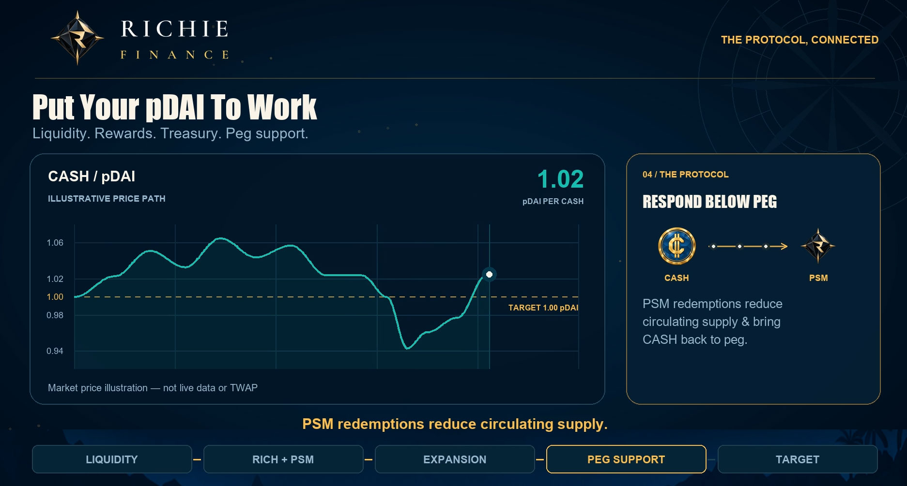

# Peg defense

Richie Finance targets a market price of **1 PDAI per CASH**. Its defense strategy combines supply discipline, PSM funding, and revenue developed through an actively managed treasury.

The objective is to build resources before they are needed and make measured use of them when the market is under pressure. We call that **peg defense through offense**.

## Build during stronger conditions

As explained in [revenue generation](revenue-generation.md) the protocol has multiple sources of income that are intended to build a war chest of assets to be used for revenue growth and expansion. This treasury of assets can then be used to support the protocol below peg to return it back to the target of 1:1.

## Respond during contraction

When the TWAP of CASH to PDAI is below 1.01:

1. CASH expansion pauses.
2. Assess treasury liquid reserves, realized revenue, outstanding obligations, and market depth.
3. When the TWAP of CASH to PDAI is below 1.00 allocate a portion of available funding to CASH to PDAI redemptions and other disclosed peg-defense activity where appropriate.
4. Monitor the result while preserving capacity for further operations.

## What a CASH redemption does

When below peg of 1.00 CASH can be redeemed 1:1 for pDAI, this adds demand in the market through arbitrage and reduces circulating CASH supply with the aim of bringing it back to peg. Redeemed CASH may be held, burned, or otherwise managed.

Peg defense is measured against PDAI. Maintaining the CASH/PDAI ratio does not protect either asset's US dollar value.

