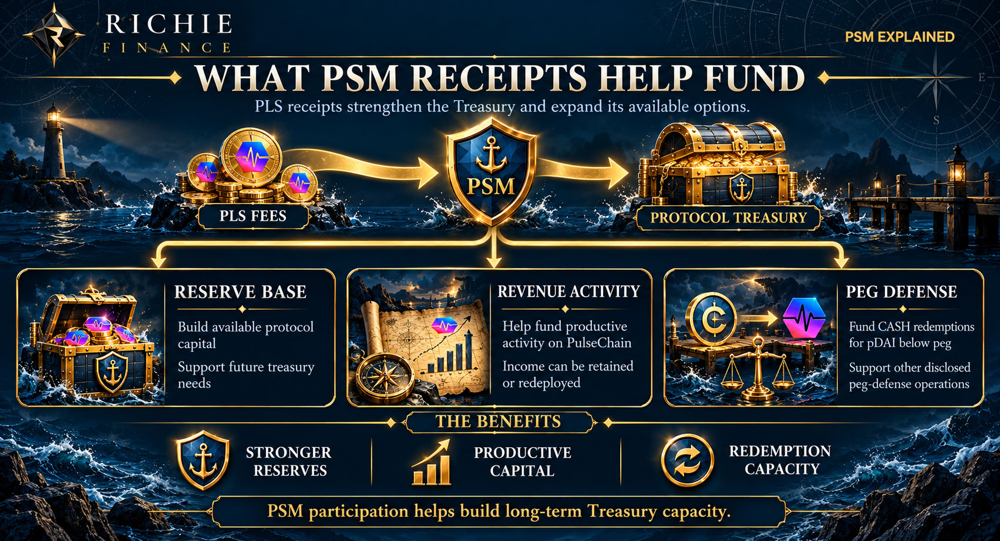

# Peg Stability Module

The **Peg Stability Module (PSM), is the primary treasury building mechanism in Richie Finance.** It links LP growth with a funding mechanism that supports treasury reserves, revenue development, and peg redemptions.

The PSM fee applies only to RICH rewards earned in The Marina from staking LP tokens, the fee is set as 30% of the value of your unclaimed RICH rewards. It does not tax deposited principal, PDAI transfers, or PDAI entering or leaving the ecosystem.

## How RICH reward claims work

1. A participant earns RICH rewards by staking either CASH/PDAI or RICH/PLS LP tokens in The Marina.
2. The value of your RICH rewards is calculated using a TWAP value, the PSM fee is 30% of this value.
3. The participant pays the required PSM fee in PLS and receives the earned RICH rewards.
4. PSM receipts flow to the protocol treasury to be used for revenue generation and CASH redemptions below peg.
5. The user is free to do as they wish with the claimed RICH: make and stake more RICH/PLS LP, stake RICH in The Yacht Club, or sell it on Pulsex.

## What the PSM fee funds

PSM receipts contribute to a reserve base and help fund revenue-generating activity on Pulsechain. A portion of available capital is used to support CASH redemptions for PDAI when below peg and other disclosed peg-defense operations.

The starting PSM fee is 30% of the value of your accrued RICH rewards. **PSM fee in PLS = claim value of RICH in PLS × 30%.** For example, a claim value of RICH tokens worth 1,000 PLS with a 30% fee rate would require 300 PLS in fees, plus normal transaction gas fees. You are then transferred the full amount of RICH tokens you had unclaimed.

The PSM fee and network gas are different costs, even though both are paid in PLS. Participants need enough PLS for both. Any excess PLS is immediately repaid to the user in the same transaction.

See [claiming rewards](../guides/claiming-rewards.md) and [revenue generation](revenue-generation.md).