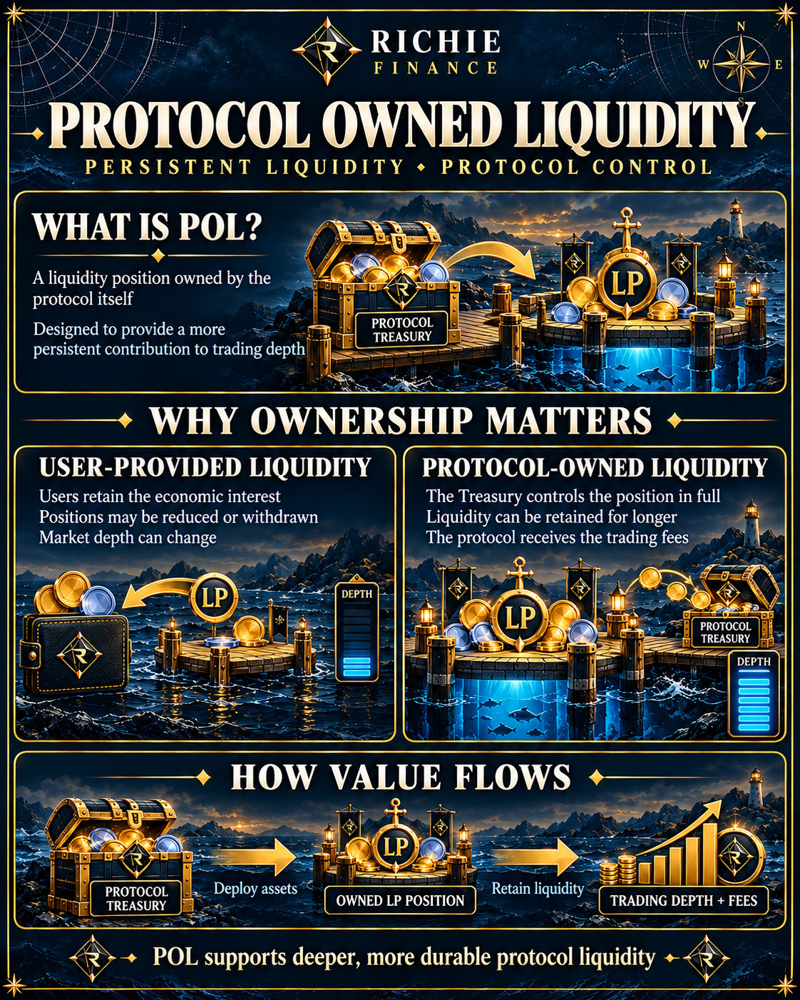

# Protocol owned liquidity

Protocol owned liquidity, or POL, is a liquidity position owned by the protocol itself. It can provide a more persistent contribution to trading depth than liquidity that depends entirely on farm incentives.

## Why POL matters

When users provide liquidity, they retain the economic interest in their positions. They may withdraw or reduce their position size, which can reduce market depth.

When the treasury owns a position, the protocol controls that position in full. It therefore retains liquidity for longer and receives the associated trading fees.

## POL and the PDAI ecosystem

A treasury-owned CASH/PDAI position supports trading depth for PDAI on Pulsechain. Liquidity depth helps markets function; it does not enforce a peg. A pool can become dominated by a falling asset, and trading fees may be smaller than losses in its underlying assets.
