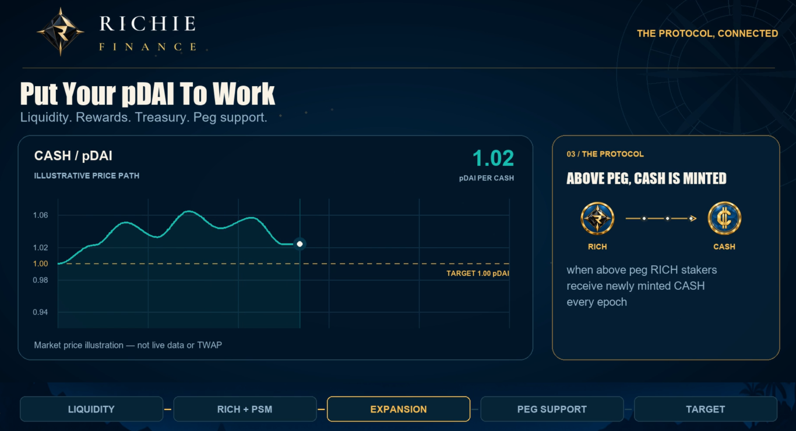

# CASH Token

**$CASH is Richie's algorithmic peg token, designed to fluctuate around 1 PDAI per CASH on PulseChain.** 

## Understanding the PDAI peg target

As the CASH price may be volatile at times the protocol uses a TWAP (Time Weighted Average Price) to calculate the manipulation resistant average price of CASH in relation to PDAI over the last 6 hour window, it does not use the current live dex trading price when determining its current peg value.

The target does not define a US dollar value. If PDAI's dollar price changes, a CASH token trading exactly at its PDAI target changes in dollar value alongside it.

## Supply expansion and contraction

When CASH trades above its peg to PDAI new CASH is minted in order to increase supply to match its current market demand and bring it closer to the 1:1 peg. Every epoch (6 hour window) this is calculated using the TWAP mentioned above and if new supply is to be minted it is minted to RICH stakers in The Yacht Club.

When CASH trades under the peg of 1:1 during a full epoch no new CASH is minted and instead the treasury will implement supply contraction methods which include utilizing available reserves and income for CASH redemptions to PDAI at a 1:1 ratio. It may also implement methods to increase the demand of CASH through the incentivization of new pools and yield opportunities. The goal is to reduce circulating supply and increase demand of CASH to meet the current market demand and push CASH back to the peg value of 1:1.


CASH does not carry a promise of redemption for one PDAI. It is not fully collateralized, and treasury asset values should not be treated as a guaranteed CASH price floor.


See [supply and epochs](supply-and-epochs.md) and [peg defense](../mechanisms/peg-defense.md).
