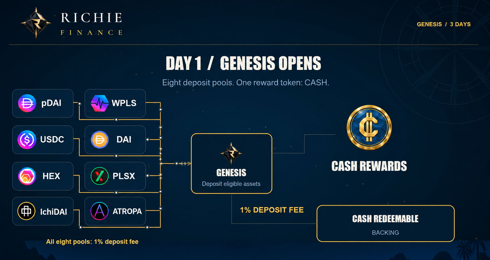
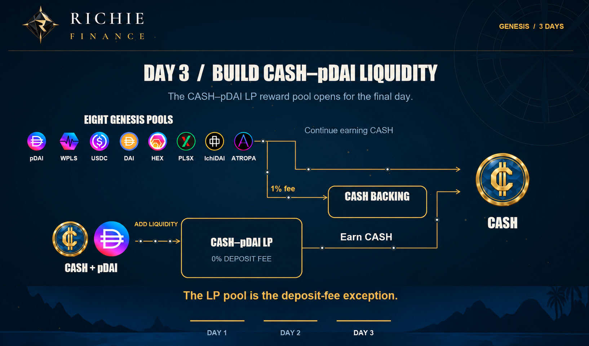

# Genesis launch

Richie's launch aims to establish usable liquidity, a disperse and even token allocation, and a strong starting position for the treasury. Dates and launch mechanics are not confirmed, they will be confirmed on socials closer to launch date. 
                                                                                                                                                                                                                                                                                                                                                                                                                                                                                                                     
## Token distribution
At deployment only 1 token of RICH and CASH is minted which is used to create the initial liquidity pairs on Pulsex V2 at an equal 1:1 ratio. The only way to earn protocol tokens is through the Genesis, The Marina farms or The Yacht Club. 

## Genesis participation

Genesis is the fairest method to distribute the initial supply of CASH among active participants in the protocol. Over 3 days users stake whitelisted Pulsechain assets and earn the initial 50,000,000 supply of CASH, this supply distributes linearly over the 3 day period. Genesis deposits carry a 1% fee however the yield in CASH generated during this 3 day genesis aims to be much larger than this fee and is not taxed.

Users are free to deposit, withdraw and claim rewards at anytime during the genesis and hold complete ownership of their assets at all times. The 1% genesis fee is sent to the treasury and used to fund the initial backing of CASH used for revenue production and peg defense.

## Full launch sequence

**Day 0** - Genesis pools of Pulsechain assets will open for pre-deposit several days before actual launch, no yield will be earned until actual launch date

**Day 1** - Genesis pools will start yielding CASH for stakers

**Day 3** - A CASH/PDAI LP pool will be added to the genesis with no deposit fee to build strong initial liquidity. Pulsechain assets deposited will continue to yield CASH as well during this time until the genesis period ends at the end of day 3.

**Day 4** - Genesis pools end and The Marina CASH/PDAI and RICH/PLS LP pools will start earning RICH shares for depositors. You may claim CASH rewards and unstake from the genesis pool at anytime. The Genesis and Marina pool contracts are different, to start earning RICH you must deposit into the specific LP pool in The Marina. 

The genesis pools will yield CASH for 3 days to depositors of various Pulsechain assets including PDAI, HEX, PLS, PLSX, ATROPA, ICHIDAI and DAI. Deposits will open several days beforehand to allow all to participate on their own time. 

The most profitable strategy for users is to earn CASH from genesis using Pulsechain assets and then create LP with that earned CASH to farm RICH at the beginning of The Marina farms when the yield APR will be the highest. Expect volatility in the early stages of the protocol. 

