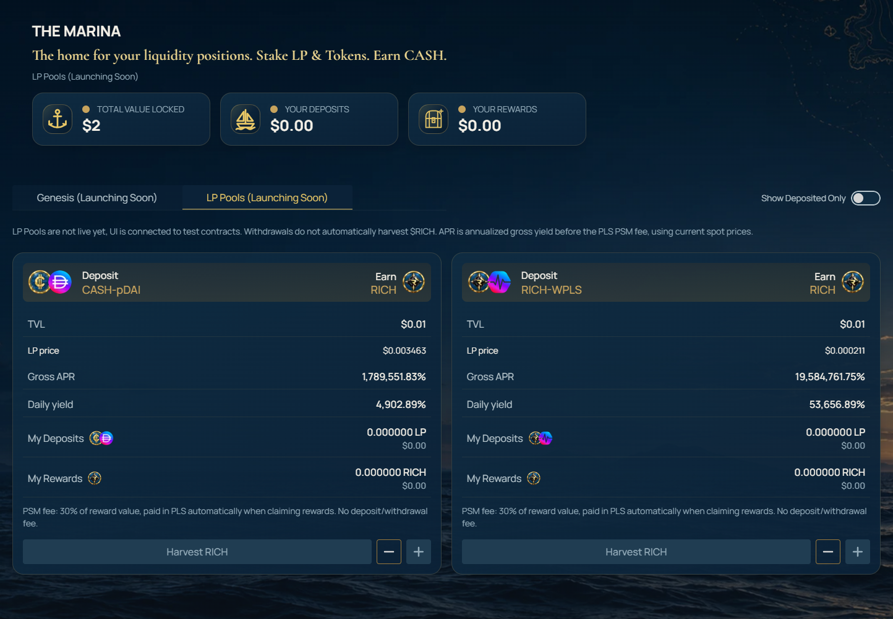
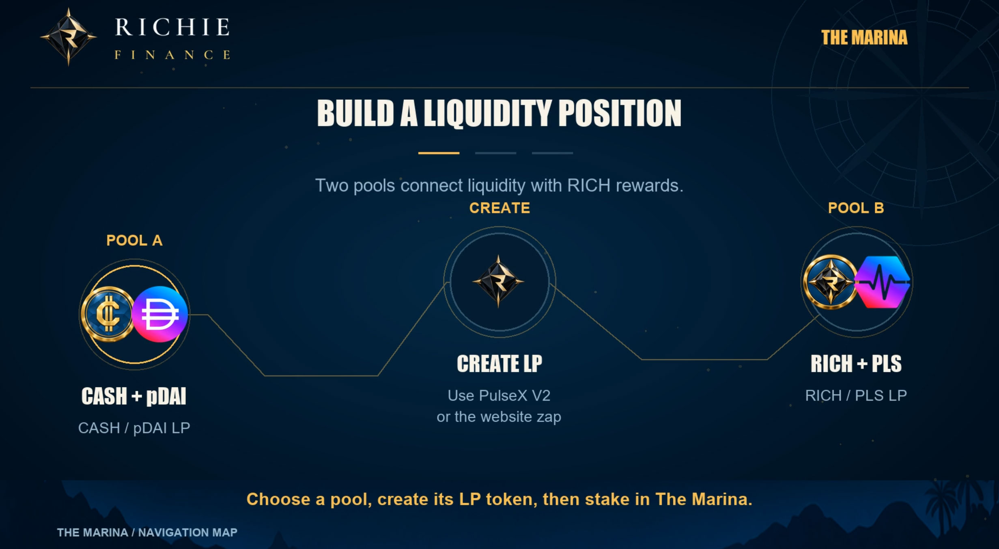
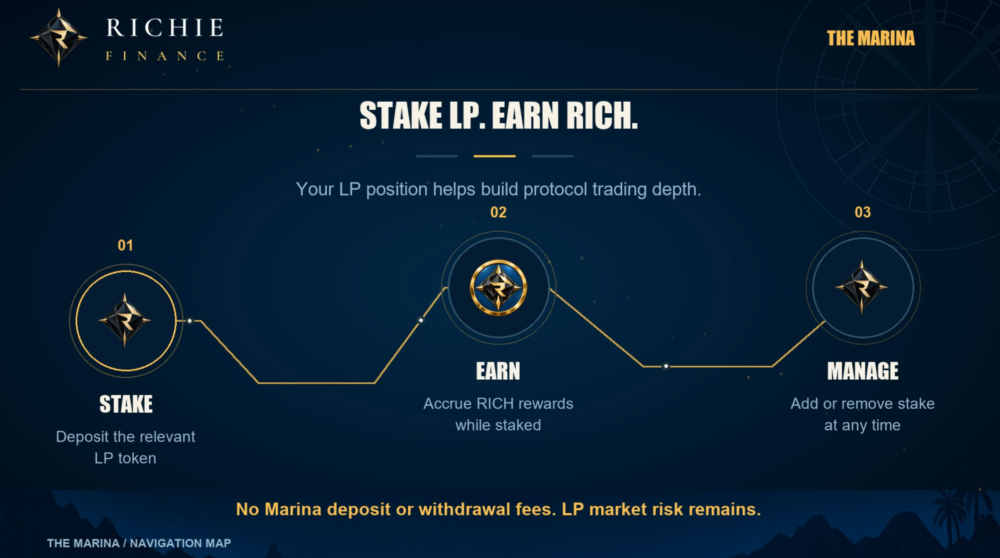

# The Marina

**The Marina is the home for your liquidity positions. Stake LP & Tokens. Earn CASH.** The goal is to incentivize the building of PDAI and protocol liquidity. The primary focus is CASH/PDAI liquidity, giving PDAI holders a way to support trading depth while earning a high yield on their PDAI holdings.

## How it works

Users create LP by either supplying tokens on Pulsex V2 in equal ratios or by using the zap feature on the website to create an LP token in one transaction using only one token of the LP. Users then stake the LP token in the relevant LP pool in The Marina and start earning RICH rewards immediately. 

Initially The Marina will have two LP pools, CASH/PDAI LP and RICH/PLS LP. Users can choose where to stake, how much to stake and can add to or remove their stake at any time without deposit or withdrawal fees.

## Reward claims and the PSM

To claim your RICH rewards requires a payment in PLS, this fee funds the Peg Stability Module and is always less than the current market value of your accrued unclaimed rewards. The PSM fee contributes to the protocol's funding base for CASH redemptions and the basket of assets used to generate treasury revenue.

The PSM applies only to your unclaimed RICH rewards, not the liquidity principal you deposit or withdraw. 

## Before depositing

Check the verified pool address, required assets, reward APRs and PSM fee schedule. Make sure you understand how V2 LP tokens work and their payoff structure.

The peg target does not remove impermanent loss risk. See [providing liquidity](../guides/providing-liquidity.md) and [risks and security](../information/risks-and-security.md).
