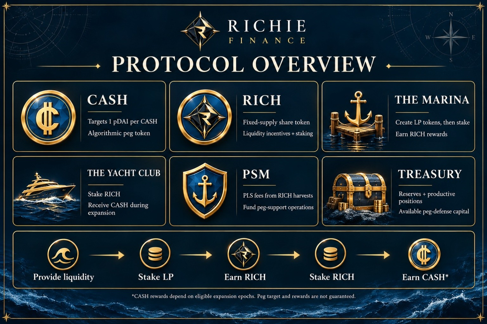
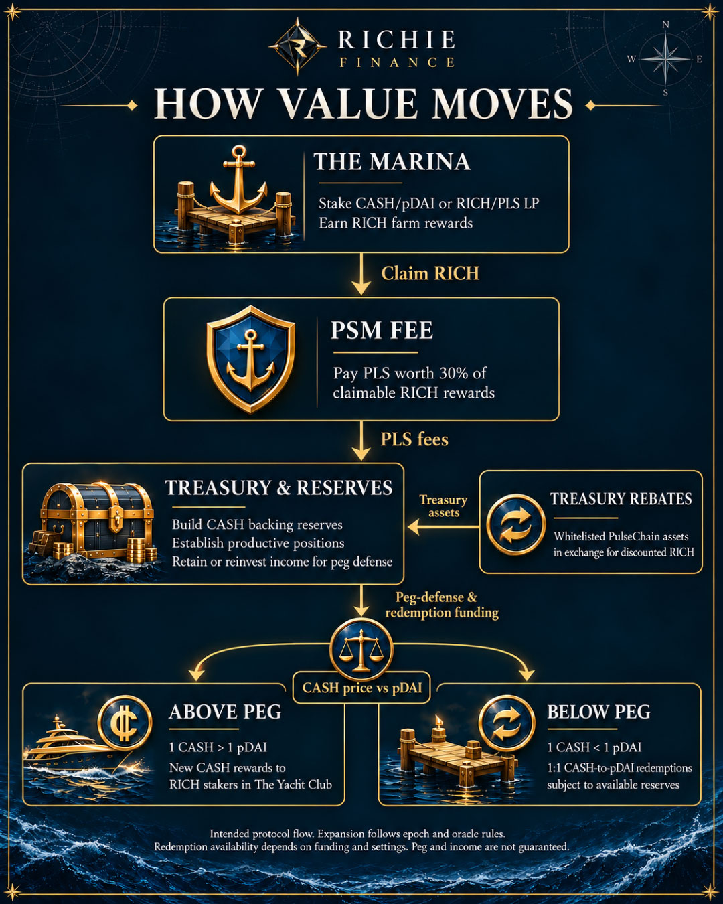

# Protocol overview

Richie connects PDAI liquidity growth with treasury development and yield. The protocol has six main components.

| Component | Intended role |
| --- | --- |
| CASH | Algorithmic peg token targeting 1 PDAI per CASH, supply expands and contracts |
| RICH | Fixed supply share token of the protocol used for LP incentives and provides stakers with the right to earn newly minted CASH tokens |
| The Marina (Liquidity farms) | Create and stake protocol LP tokens to earn RICH shares |
| The Yacht Club (RICH staking) | Distributes newly minted CASH rewards to RICH stakers |
| PSM | The Peg Stability Module, the primary method of stabilizing the CASH to PDAI peg. It's funded  by a PLS fee paid on RICH rewards earned in The Marina |
| Treasury | Reserves, productive positions, and available peg-defense capital |

## How value moves through the system

1. Users create and stake protocol LP tokens CASH/PDAI and RICH/PLS in The Marina to earn RICH farm rewards.
2. To claim these RICH rewards stakers must pay a PSM fee in PLS, this fee is 30% of the value of their claimable RICH rewards.
3. PLS earned by the PSM contributes to CASH backing reserves and allows the treasury to establish revenue-generating positions.
4. Treasury activity aims to produce income that can be retained, reinvested and used for peg defense and CASH redemptions to PDAI.
5. When the price of 1 CASH is above 1 PDAI, the protocol mints new CASH to RICH stakers in The Yacht Club. Below peg CASH redemptions to PDAI at 1:1 open for users.
6. Treasury rebates offer discounted RICH tokens in exchange for whitelisted Pulsechain assets. These assets are used to bolster the treasury and CASH redemptions.

## The role of the market

CASH's peg is a market-price target. Trading demand, liquidity, supply growth, and treasury activity all affect the CASH/PDAI ratio. No component forces every trade to execute at exactly one PDAI.

Above the peg of 1 PDAI, additional CASH supply is minted to RICH stakers in order to meet CASH demand to its circulating supply. Below peg, the protocol pauses CASH expansion and uses available revenue and treasury capacity to support CASH redemptions for PDAI thereby reducing circulating CASH supply and increasing demand.

Learn more about [The Marina](liquidity-farms.md), the [PSM](../mechanisms/peg-stability-module.md), and [revenue generation](../mechanisms/revenue-generation.md).
