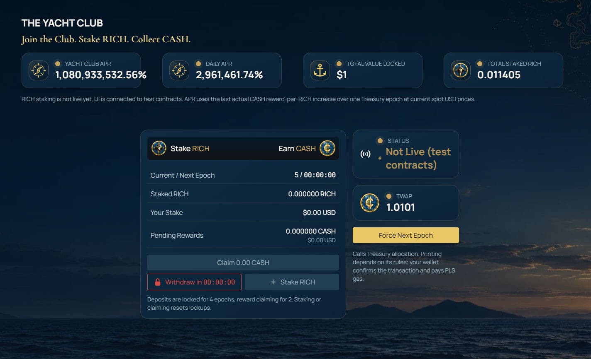
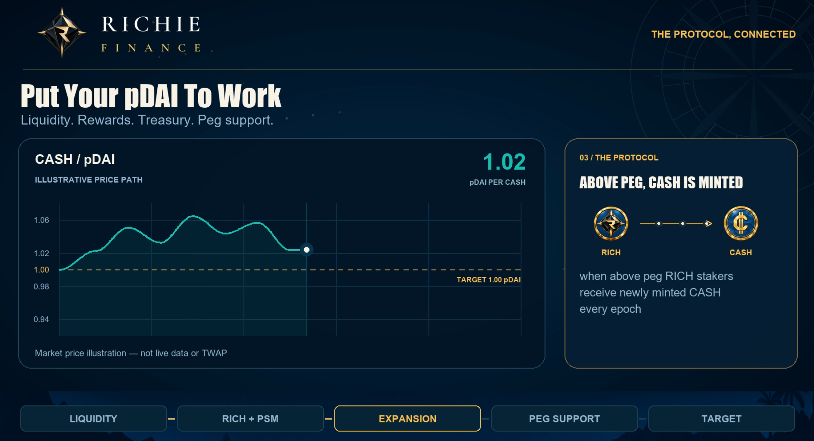
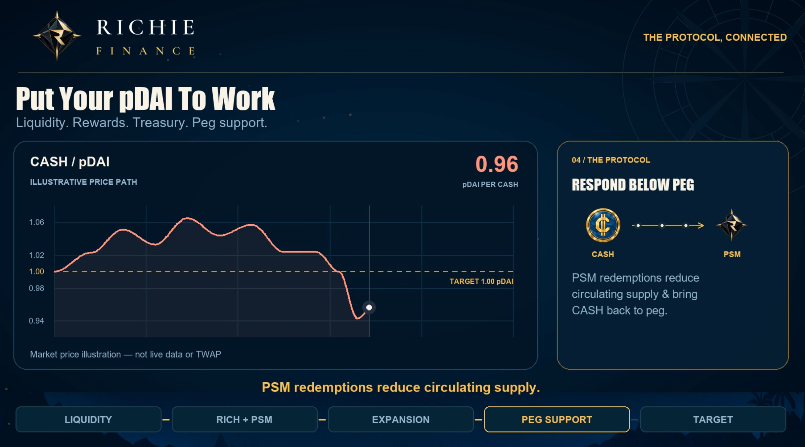

# The Yacht Club (RICH staking)

RICH staking aims to reward those who believe the most in the protocol by giving them sole seigniorage rights to earn newly minted CASH when above peg at high yields. It connects the share token with the protocol's supply policy and provides incentive to provide liquidity in The Marina for deep LP growth.

## Where rewards come from

Rewards are newly minted CASH tokens each epoch when CASH is above peg, it is a form of seigniorage designed to maintain the 1:1 CASH:PDAI ratio by increasing supply. 

Being staked does not guarantee that an epoch will produce rewards. The CASH/PDAI price observation is based on the last 6 hour TWAP price not the current live dex price.

## Contraction periods

During an epoch window (6 hours) where CASH price remains below the peg price of 1 PDAI no new CASH tokens will be minted. Treasury revenue positions continue operating during these periods, and available revenue may be used for peg defense and CASH redemptions in order to reduce circulating supply and push CASH price back to peg value. 

## Locks and claims

Each epoch period is 6 hours, there are 4 per day. The last 6 hour TWAP price of CASH determines whether it is below or above peg and therefore whether new CASH tokens are minted or not. Once staked in The Yacht Club withdrawals are locked for 4 epochs and reward claims are locked for 2 epochs. Any action of claiming, withdrawing or depositing resets these lock timers. These timers are displayed on The Yacht Club page for your convenience.  

## Fees

There are no fees for staking, withdrawing or claiming rewards in The Yacht Club.

Read [staking RICH](../guides/staking-rich.md) for the intended user journey and [parameters and fees](../information/parameters-and-fees.md) for settings.
