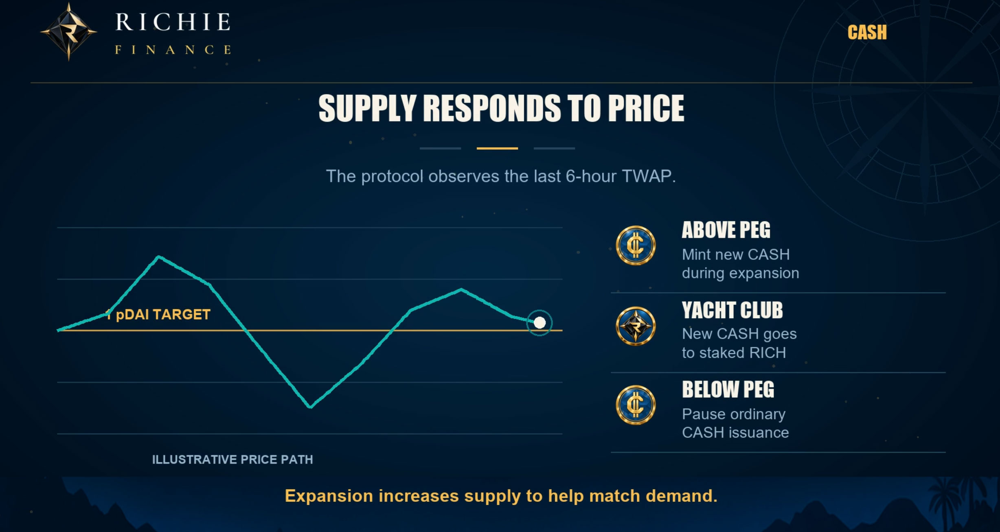
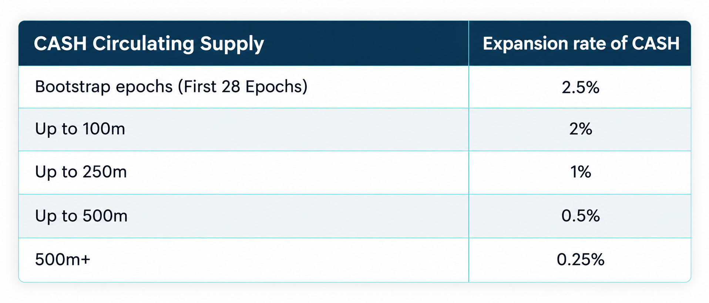
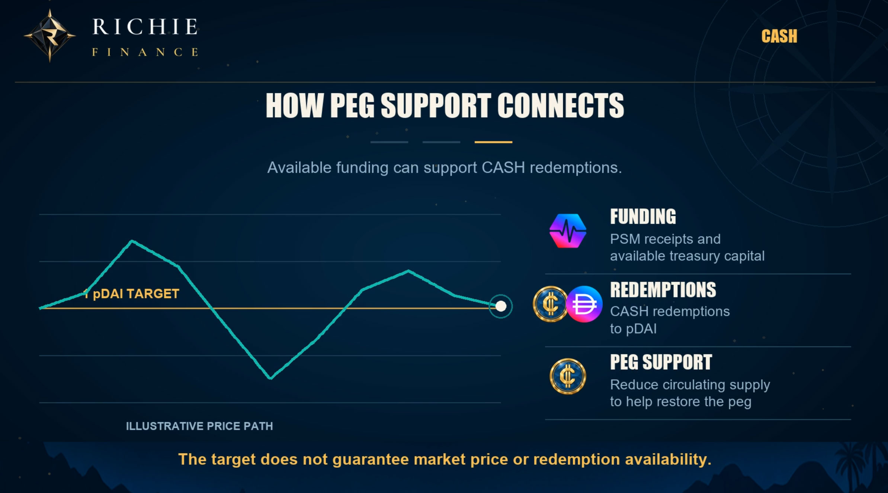

# Supply, epochs and expansion

The protocol runs on epochs which last 6 hours, there are 4 per day. Each epoch the protocol evaluates its supply and expansion policy based on the last 6 hour TWAP of CASH to PDAI.

1 CASH aims to be priced as 1 PDAI. A time-weighted average price, or TWAP, averages observations over the past 6 hours to increase manipulation resistance. It does however as a result lag the current market price that's observed on the live dex. Therefore the current live price does not equal the previous 6 hour TWAP. 

## Above peg

When CASH remains at a PDAI TWAP of 1.01 or above over the last epoch, the protocol mints new CASH and distributes it to RICH stakers in The Yacht Club based on their staked ratio of the total amount staked. 80% of newly minted CASH each epoch goes to those staked in The Yacht Club, 20% is distributed to the DAO treasury fund. Richie's revenue-focused design aims to consider earning capacity and market demand when shaping incentives.

The amount of new CASH minted each epoch depends on the current circulating supply of CASH. The first 28 epochs (7 days) after The Yacht Club launches will have a fixed 2.5% emission expansion rate per epoch to bootstrap CASH supply. 

This bootstrap period will run regardless of whether CASH is above or below peg during this time. After this period CASH expansion will follow the schedule as shown in the below table, the emission structure can be changed based on market conditions and performance.

## Below peg

During periods when the CASH:PDAI TWAP is below 1.01, CASH expansion is paused. Below a TWAP of 1.00 PSM receipts and treasury income, where available, provide separate potential funding for market support and CASH redemptions to PDAI which reduce CASH circulating supply.

